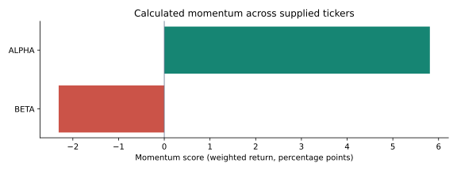

# Financial Research Assistant

A reproducible research pipeline that combines **Python-calculated momentum**
with **dated document evidence** and an optional **CrewAI analyst/reviewer chain**.
It is the consolidated workflow from the original financial and agent prototypes.

## Run the offline demo

Python 3.11–3.13 is covered by CI. No API key, model download, market connection
or database is needed for this demo.

```bash
python -m venv .venv
# Activate: .venv\Scripts\Activate.ps1, or source .venv/bin/activate
python -m pip install -r requirements.txt
python main.py --demo
```

Open `output/report.md`. The same run creates `output/report.json`,
`output/signals.csv` and `output/momentum.svg`. The ALPHA and BETA prices,
organizations and reports are entirely synthetic.

[Read the generated sample report](docs/demo-report.md)



## What is checked

| Component | Behavior |
|---|---|
| Price engine | Validates positive finite prices, unique ticker/date pairs and at least 22 observations |
| Historical cutoff | Excludes prices and documents dated after the requested analysis date |
| Returns | Calculates 1-, 5- and 21-observation returns; prefers adjusted close if present |
| Momentum | 0.4 × daily + 0.4 × weekly + 0.2 × monthly, before rounding |
| Example allocation | Equal weighting with integer basis points summing to 100% |
| Retrieval | Lexical matches scoped to the ticker and explicit publication date |
| Optional agents | Analyst and evidence reviewer return structured notes |
| Output checks | Validate dates, finite values, weight totals, momentum consistency and cited quotes |

This is a research workflow. It contains no trained ML model, predictive accuracy
claim or backtest. The example allocation is not an optimized portfolio.

## Analyze your own files

```bash
python main.py --csv prices.csv --symbols AAPL MSFT --as-of 2025-02-11 --reports reports --output-dir output
```

CSV columns: Symbol (or Ticker), Date in YYYY-MM-DD format, and Close
(or Adj Close). The date is inclusive. Horizons count **observations**, which
should be trading sessions in a real dataset. Sorting is automatic; duplicates
and insufficient history cause explicit errors rather than silently dropping tickers.

A reports directory contains an index.json plus .txt, .md or text-based .pdf files:

```json
[
  {"filename": "company-report.pdf", "ticker": "AAPL", "published_at": "2025-01-15"}
]
```

Use ticker "*" only for genuinely shared macroeconomic sources. Dates are supplied
by the operator; the pipeline cannot independently prove their accuracy.
Omit --reports to run numeric analysis without document evidence. Missing
evidence is reported explicitly and does not produce an invented risk score.

## Optional Qwen agents

```bash
python -m pip install -r requirements-agent.txt
# Configure QWEN_API_KEY in the environment or in a local .env file.
python main.py --demo --llm
```

The analyst drafts structured notes; the reviewer checks them against the same
snapshot. A deterministic validator rejects unknown sources, cross-company
citations, non-verbatim quotes and unsupported numeric values. Python remains
the source of all calculated numbers.

Agent mode sends the selected calculations and excerpts to the configured Qwen
endpoint and can incur provider charges. It is explicitly opt-in.
Live provider behavior is not validated by offline tests.

## Tests and Docker

```bash
python -m unittest discover -s tests -v
docker build -t financial-research .
docker run --rm financial-research --demo
```

CI runs the offline tests and uploads the synthetic report as a workflow artifact.
[Methodology and limitations](docs/methodology.md) explain exactly what the checks
establish. Docker needs a running engine; the image installs only offline
dependencies. Mount /app/output to retain container results.

The old FInal_project/main.py path delegates to the root CLI. The *_mcp.py
files offer a small local JSON-RPC compatibility interface; they are **not a
complete Model Context Protocol server**.
